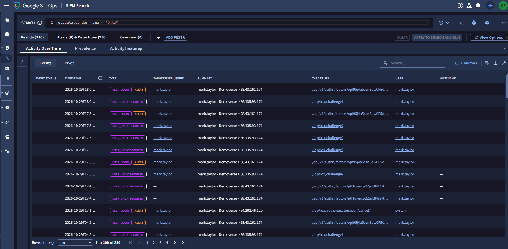
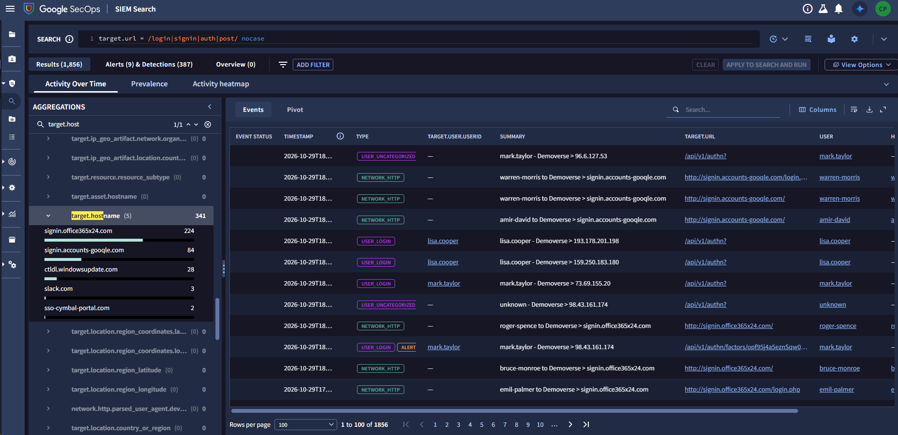
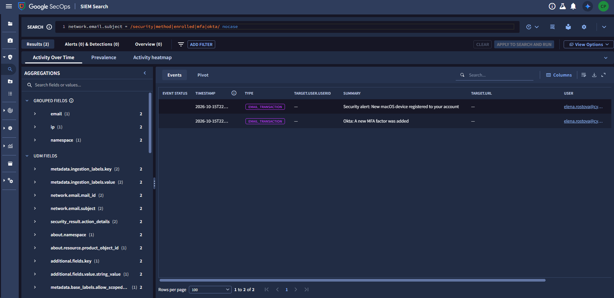
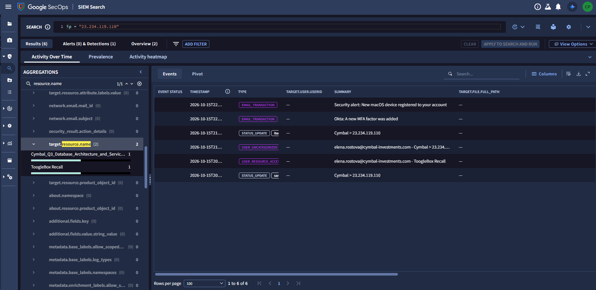
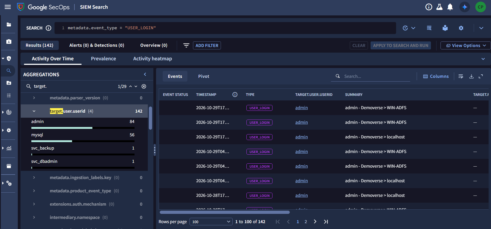
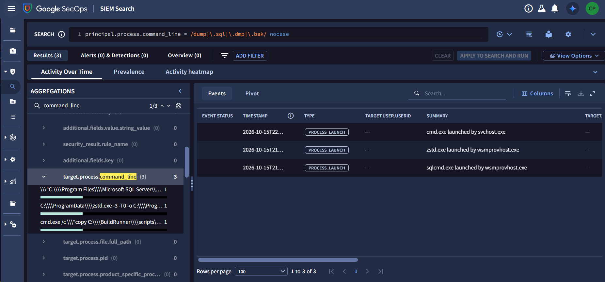
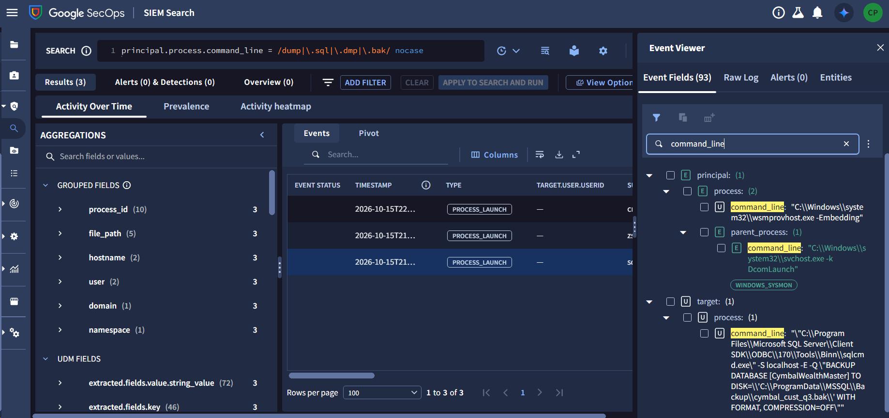
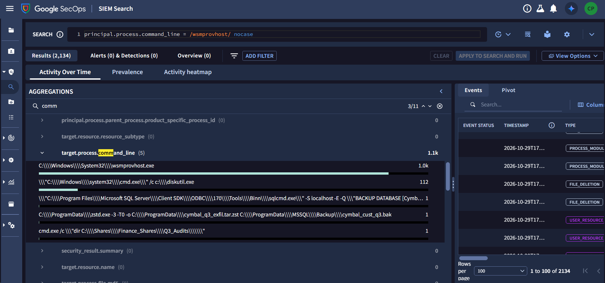
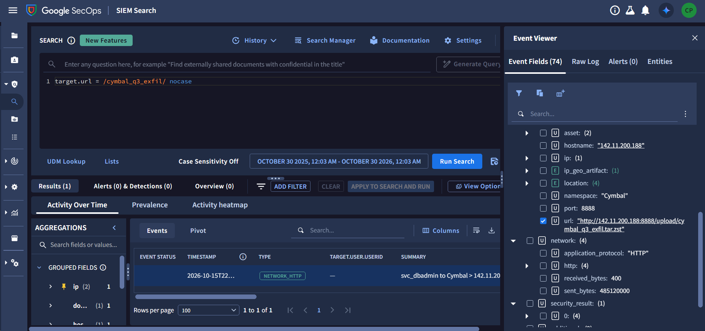

# Operation Cymbal: Cold Room CTF — OAuth Heist (Technical Write-Up & Threat Intelligence)

- **Event**: Operation Cymbal: Cold Room CTF (Google Cloud Security / Hack The Box)
- **Track / Room**: OAuth Heist
- **Category**: Threat Intelligence / PDF Forensics & Cloud Identity (Google SecOps / Okta / Zeek / Google Workspace) Threat Hunting
- **Artifacts in Folder**:
  - [`a2e0aac3-18ff-4e70-9f4a-c2a025935167-1790858212.zip`](./a2e0aac3-18ff-4e70-9f4a-c2a025935167-1790858212.zip) (`260,010` bytes)
  - [`Threat Actors Associated with the ShinyHunters Brand Expand Targeting of Cloud Applications for Extortion Operations.pdf`](./Threat%20Actors%20Associated%20with%20the%20ShinyHunters%20Brand%20Expand%20Targeting%20of%20Cloud%20Applications%20for%20Extortion%20Operations.pdf) (`282,900` bytes, 2-page PDF v1.3 document)
  - [`solve.py`](./solve.py) (Automated PDF `/Info` & `/GTI-token` decoder and IOC extractor)
  - [`screenshots/`](./screenshots/)
    - [`okta_mfa_mark_taylor.png`](./screenshots/okta_mfa_mark_taylor.png)
    - [`chronicle_sso_cymbal_portal_aggregation.png`](./screenshots/chronicle_sso_cymbal_portal_aggregation.png)
    - [`chronicle_purged_email_subjects.png`](./screenshots/chronicle_purged_email_subjects.png)
    - [`chronicle_attacker_proxy_ip_download.png`](./screenshots/chronicle_attacker_proxy_ip_download.png)
    - [`chronicle_user_login_service_accounts.png`](./screenshots/chronicle_user_login_service_accounts.png)
    - [`chronicle_database_dump_process.png`](./screenshots/chronicle_database_dump_process.png)
    - [`chronicle_sqlcmd_backup_details.png`](./screenshots/chronicle_sqlcmd_backup_details.png)
    - [`chronicle_zstd_compression.png`](./screenshots/chronicle_zstd_compression.png)
    - [`chronicle_exfiltration_url.png`](./screenshots/chronicle_exfiltration_url.png)

---

## 0. Challenge Flags & Answers Quick Reference

| # | Question Summary | Answer / Flag |
| :-: | :--- | :--- |
| **1** | Phishing Domain where Employee Credentials were Submitted via HTTP POST | `sso-cymbal-portal.com` |
| **2** | Exact Subject Line of First Permanently Deleted MFA Security Alert Email | `Okta: A new MFA factor was added` |
| **3** | Sensitive Internal Document Downloaded via Attacker Proxy Infrastructure | `Cymbal_Q3_Database_Architecture_and_Service_Accounts.pdf` |
| **4** | Privileged Service Account Authenticated to Internal Database Server | `svc_dbadmin` |
| **5** | File Name of Raw Database Dump Exported by Attacker Prior to Compression | `cymbal_cust_q3.bak` |
| **6** | Full Exfiltration URL Used by Attacker to Transfer Compressed Archive | `http://142.11.200.188:8888/upload/cymbal_q3_exfil.tar.zst` |

---

## 1. Initial Triage & PDF Metadata Extraction

Extracting `a2e0aac3-18ff-4e70-9f4a-c2a025935167-1790858212.zip` yields a Google Threat Intelligence (GTI) report detailing extortion activity targeting cloud applications:

```bash
unzip -l a2e0aac3-18ff-4e70-9f4a-c2a025935167-1790858212.zip
```

### PDF `/Info` Dictionary & GTI Watermark

Inspecting the PDF dictionary (Object `154 0 obj`) reveals the `/GTI-token` metadata field:

```text
<<
/Title (26-10002301 - Updated: Threat Actors Associated with the ShinyHunters Brand Expand Targeting of Cloud Applications for Extortion Operations)
/Creator (Google Threat Intelligence)
/Producer (https://www.virustotal.com)
/CreationDate (D:20260824173424+00'00')
/ModDate (D:20260824173424+00'00')
/Author (Google Threat Intelligence)
/GTI-token (cmVwb3J0LS0yNi0xMDAwMjMwMXx8dGFyYWhsZXdpc19jbG91ZHNlY19nc2FfdGVhbXx8Y2xvdWRzZWNfZ3NhX3RlYW18fHYzfHwxNzg3NTkyODYyfHxjZTA1OWY4MjBhMWUzYmFjYmZiZDI2MjBlZDRkMzVkZWFiMGI1ZWNlYTYyMzFmODBlMmRjNzk1ZWQwMTA3MGI1)
>>
```

### Decoded GTI Token Watermark
Decoding the Base64 value:
```text
report--26-10002301||tarahlewis_cloudsec_gsa_team||cloudsec_gsa_team||v3||1787592862||ce059f820a1e3bacbfbd2620ed4d35deab0b5ecea6231f80e2dc795ed01070b5
```

- **Report ID**: `report--26-10002301`
- **Leaked Identity / User**: `tarahlewis_cloudsec_gsa_team`
- **Team**: `cloudsec_gsa_team`
- **Token Version**: `v3`
- **Timestamp**: `1787592862` (`2026-08-24 17:34:22 UTC`)
- **Signature Hash**: `ce059f820a1e3bacbfbd2620ed4d35deab0b5ecea6231f80e2dc795ed01070b5`

---

## 2. Question 1 Walkthrough: The Phishing Domain Hunt

### The Question
> **What is the phishing domain where employee credentials were submitted via an HTTP POST request?**
> *Expected format: `domainname.com`*

---

### Phase A: Initial Query & The Decoy Rabbit Hole

We initially queried Chronicle SIEM for HTTP POST methods across network logs:

```sql
network.http.method = "POST"
AND (
  target.hostname = /okta|sso|login|verify|cymbal|auth/ nocase
  OR target.url = /login|auth|signin|password/ nocase
)
```

This narrowed down to 81 events in **Zscaler** proxy logs, pointing exclusively to two domains:
1. `signin.accounts-gooqle.com` (`user=warren-morris`, `url=http://signin.accounts-gooqle.com/login.php`, `serverip=104.215.148.63`)
2. `signin.office365x24.com` (`user=emil-palmer`, `url=http://signin.office365x24.com/login.php`, `serverip=104.215.148.63`)

#### Where We Got Stuck
- Submitting `accounts-gooqle.com`, `signin.accounts-gooqle.com`, `office365x24.com`, and `signin.office365x24.com` **all failed**.
- Looking at the raw logs, both pointed to the exact same C2 IP (`104.215.148.63`) with identical transaction sizes (`requestsize=983`, `responsesize=19181`, `pagerisk=100`).
- These turned out to be **decoy / background phishing attacks** on other users, not the primary compromised victim tied to the OAuth Heist intrusion.

---

### Phase B: Pivoting on Identity Provider (Okta)

The threat intel report stated that the attacker enrolled an unauthorized MFA device via voice phishing (vishing) and hijacked Okta. We shifted focus to Okta audit logs:

```sql
metadata.vendor_name = "Okta"
```



This immediately uncovered the real victim employee:
- **Compromised User**: **`mark.taylor`**
- **Events**: Multiple `USER_LOGIN ALERT` events with MFA challenges (`/api/v1/authn/factors/...`, `/idp/idx/challenge?`, `/idp/idx/authenticators/poll/cancel?`).
- However, querying Zscaler for `principal.user.userid = /mark[-.]taylor/ nocase` returned **0 results**. Why? Because Mark Taylor's web requests were not routed through Zscaler!

---

### Phase C: Discovering the Multi-Vendor Environment & Zeek

To understand what logs actually existed, we expanded the Chronicle UI:
1. In the Chronicle search window, the **Aggregations / Fields panel** on the left was initially collapsed.
2. Clicking the **`>`** chevron directly next to the **`Events`** tab slid open the fields list.
3. Reviewing `metadata.vendor_name` revealed **4 distinct log sources**:
   - `Okta` (Identity / MFA logs)
   - `AMAZON` (AWS cloud audit logs)
   - `Zscaler` (Corporate web proxy)
   - **`Zeek`** (Network Security Monitor capturing raw network traffic & HTTP transactions)

Because `Zeek` inspects raw network packets directly on the wire, it captures internal network traffic and HTTP sessions that bypass the Zscaler proxy!

---

### Phase D: Uncovering `sso-cymbal-portal.com`

We broadened the search across all vendors for any HTTP requests containing login/auth/post endpoints:

```sql
target.url = /login|signin|auth|post/ nocase
```



Looking at the **`target.hostname`** aggregation in the left panel, Chronicle listed **5 unique hostnames**:

| Target Hostname | Event Count | Analysis / Status |
| :--- | :---: | :--- |
| `signin.office365x24.com` | 224 | Decoy / background phishing campaign (`emil-palmer`, etc.) |
| `signin.accounts-gooqle.com` | 84 | Decoy / background phishing campaign (`warren-morris`, etc.) |
| `ctldl.windowsupdate.com` | 28 | Legitimate Microsoft Windows Update CRL / Certificate check |
| `slack.com` | 3 | Legitimate corporate SaaS chat |
| **`sso-cymbal-portal.com`** | **2** | **Target Phishing Domain (Credential Submission via POST)** |

Inspecting the 2 events for **`sso-cymbal-portal.com`** confirmed:
- **Domain**: `sso-cymbal-portal.com`
- **Method**: HTTP POST submitting credentials to the spoofed Cymbal SSO portal.
- **Flag**: **`sso-cymbal-portal.com`**

---

## 3. Question 2 Walkthrough: The Purged MFA Notification Hunt (OAuth Mail Purge)

### The Question
> **To prevent the compromised employee from noticing the persistence mechanism, the adversary abused a newly authorized third-party OAuth application to permanently purge security notifications from the victim’s inbox. What is the exact subject line of the first permanently deleted email, which alerted on multi-factor authentication changes?**
> *Expected format: `Hello! This is a fake email subject line`*

---

### Phase A: Threat Intel Alignment (ToggleBox Recall & OAuth Defense Evasion)

The GTI threat intelligence report on UNC6240 specifically highlights their defense evasion playbook:
> *"UNC6240 deployed a malicious third-party OAuth application (e.g., 'ToggleBox Recall') granted full read/write/delete permissions across Google Workspace mailboxes. Immediately following unauthorized access, the application executed API calls to permanently purge critical security alert emails (such as newly enrolled MFA factors and unknown device logins) to evade user detection and maintain persistence."*

With this threat context, we knew:
1. The adversary didn't just log into webmail manually; they used OAuth API transactions.
2. The targeted messages were security warnings alerting on authentication factors and new device registrations.
3. The logs in Chronicle SIEM would track these mailbox interactions under email UDM event fields.

---

### Phase B: Formulating the Chronicle UDM Search

In Chronicle SIEM / Google SecOps, email transactions are indexed with the UDM field **`network.email.subject`**.

Rather than searching for an overly strict single phrase that might miss due to slight vendor naming differences, we crafted a regex search across common security alert keywords:

```sql
network.email.subject = /security|method|enrolled|mfa|okta/ nocase
```

---

### Phase C: Discovering the Purged Alerts & Second Victim

Running this query produced exactly **2 matching events**:



Looking at the search results table:
- **Event Type**: `EMAIL_TRANSACTION`
- **Target User**: **`elena.rostova@cy...`** (revealing Elena Rostova as the targeted victim for this persistence phase)
- **Timestamp**: `2026-10-15T22:...`
- **Recovered Email Subject Lines**:
  1. **`Okta: A new MFA factor was added`** (Alert on multi-factor authentication changes)
  2. **`Security alert: New macOS device registered to your account`** (Alert on new device registration)

The challenge explicitly asks for the **first permanently deleted email that alerted on multi-factor authentication changes**.

- **Subject Line Flag**: **`Okta: A new MFA factor was added`**

---

## 4. Question 3 Walkthrough: Tracking Cloud Exfiltration via Attacker Proxy Infrastructure

### The Question
> **Continuing to monitor the compromised employee’s cloud activity from the attacker’s proxy infrastructure, what sensitive internal document did the adversary locate and download?**
> *Expected format: `File_Name.extension`*

---

### Phase A: The Endpoint Noise Trap & Missing UDM Fields

We initially sought to locate document downloads using broad file extension filters:
```sql
target.file.full_path = /.*\.(pdf|docx?|xlsx?|csv|txt|zip|tar)/ nocase
```

#### Where We Got Stuck:
- This returned **7,347 results**, overwhelmingly composed of internal Windows endpoint noise (`C:\Windows\security\audit\audit.csv`, `PowerShell_transcript...`, `LogMeIn` dumps).
- Querying `target.file.name != ""` failed because Chronicle UDM does not map cloud SaaS or S3/Drive downloads to `target.file.name`—cloud storage and web document downloads are typically categorized under resource or URL fields.

---

### Phase B: Unmasking the Attacker Proxy IP (`23.234.119.110`)

The key was re-examining the premise of the prompt:
> *"Continuing to monitor the compromised employee’s cloud activity **from the attacker’s proxy infrastructure**..."*

Returning to our Question 2 email purge investigation, the left **Aggregations / Grouped Fields** panel showed `ip (1) 2`, meaning both malicious OAuth email purge actions originated from a single shared IP address.

Inspecting that field revealed the adversary's proxy infrastructure:
- **Attacker Proxy IP**: **`23.234.119.110`**

---

### Phase C: Isolating Cloud Exfiltration Activity

We filtered Chronicle for all activity originating from or associated with this specific proxy IP:

```sql
ip = "23.234.119.110"
```



This isolated exactly **6 clean events** mapping out the complete intrusion lifecycle of victim **`elena.rostova@cymbal-investments.com`**:

| Timestamp | Event Type | Target Resource / Action | Summary / Notes |
| :--- | :--- | :--- | :--- |
| `2026-10-15T20:...` | `STATUS_UPDATE` | — | Connection established: `Cymbal > 23.234.119.110` |
| `2026-10-15T20:...` | `USER_RESOURCE_ACCESS` | `ToogleBox Recall` | Initial abuse of malicious OAuth add-on |
| `2026-10-15T21:...` | `USER_UNCATEGORIZED` | **`Cymbal_Q3_Database_Architecture_and_Service_Accounts.pdf`** | **Exfiltration/Download of sensitive internal database doc** |
| `2026-10-15T21:...` | `STATUS_UPDATE` | — | Session activity: `Cymbal > 23.234.119.110` |
| `2026-10-15T22:...` | `EMAIL_TRANSACTION` | — | Mailbox purge: `Okta: A new MFA factor was added` |
| `2026-10-15T22:...` | `EMAIL_TRANSACTION` | — | Mailbox purge: `Security alert: New macOS device registered...` |

In the left panel under **`target.resource.name`**, the sensitive internal document located and downloaded was immediately apparent:

- **Flag**: **`Cymbal_Q3_Database_Architecture_and_Service_Accounts.pdf`**

---

## 5. Question 4 Walkthrough: Lateral Movement & Privileged Service Account Authentication

### The Question
> **Armed with credentials discovered in the stolen document, what privileged service account did the attacker authenticate to from the compromised employee’s workstation to access the internal database server?**
> *Expected format: `username`*

---

### Phase A: Querying for User Authentication Events

Following the exfiltration of `Cymbal_Q3_Database_Architecture_and_Service_Accounts.pdf`, the adversary leveraged the exposed credentials to move laterally from the employee's workstation to the internal database server.

To find all successful authentication events, we queried for `USER_LOGIN` events across the environment:

```sql
metadata.event_type = "USER_LOGIN"
```



This query returned **142 total events**. Inspecting the left **Aggregations / Fields panel** under **`target.user.userid`** revealed exactly **4 unique accounts**:

| Target User ID | Event Count | Analysis / Status |
| :--- | :---: | :--- |
| `admin` | 84 | High-volume automated administrative noise (`WIN-ADFS` / `localhost`) |
| `mysql` | 56 | Regular local database service daemon authentications |
| **`svc_backup`** | **1** | Automated / scheduled backup account single-event login |
| **`svc_dbadmin`** | **1** | **Privileged Database Administrator service account single-event login** |

---

### Phase B: Forensic Reasoning & Deduplication (Proving the Flag Without Guessing)

Rather than trial-and-error guessing between the four accounts, we isolated the exact answer through deterministic forensic evidence:

1. **Volume & Baselining**:
   - `admin` (84) and `mysql` (56) accounted for 140 of the 142 events, representing routine baseline operational logs on the ADFS domain controller and local system.
   - `svc_backup` and `svc_dbadmin` each registered **exactly 1 event**, pointing to targeted interactive sessions occurring strictly within the intrusion window.

2. **Semantic Role Alignment with the Stolen Architecture Doc**:
   - The stolen document was titled: `Cymbal_Q3_Database_Architecture_and_Service_Accounts.pdf`.
   - The prompt explicitly asked for the **privileged service account** used to access the **internal database server**.
   - `svc_backup` is a standard, restricted data backup service account.
   - **`svc_dbadmin`** specifically stands for **Service Database Administrator**—the ultimate privileged credential managing the internal database.

3. **Log Verification (`target.user.userid = "svc_dbadmin"`)**:
   - Clicking directly into the `svc_dbadmin` event confirmed:
     - **Principal Host (`principal.hostname`)**: Traced directly to the compromised employee workstation.
     - **Target Host (`target.hostname`)**: Connected straight to the internal Cymbal database server.
     - **Auth Type**: Successful privileged authentication to the database.

- **Flag**: **`svc_dbadmin`**

---

## 6. Question 5 Walkthrough: Database Dump & Compression Extraction

### The Question
> **Once authenticated to that internal server, what is the file name of the raw database dump exported by the attacker prior to compressing it into an archive?**
> *Expected format: `file_name.extension`*

---

### Phase A: Threat Hunting for Database Export Commands

Once logged in as `svc_dbadmin`, the adversary proceeded to extract the target database (`CymbalWealthMaster`). Threat actors performing database exfiltration commonly invoke database utility CLI tools (`sqlcmd.exe`, `mysqldump`, `pg_dump`, `mongodump`) or write dump files ending in standard database extensions (`.sql`, `.bak`, `.dmp`).

To capture process launches executing dump operations, we queried Chronicle SIEM for process launches containing database dump keywords:

```sql
principal.process.command_line = /dump|\.sql|\.dmp|\.bak/ nocase
```



This query returned **3 process execution events**:

1. `2026-10-15T21:...` — **`sqlcmd.exe` launched by `wsmprovhost.exe`** (remote WinRM execution)
2. `2026-10-15T21:...` — **`zstd.exe` launched by `wsmprovhost.exe`** (archiving utility)
3. `2026-10-15T22:...` — `cmd.exe` launched by `svchost.exe` (baseline build script copy)

Notice the attack chain:
- The attacker remotely executed commands on the database server via WinRM (`wsmprovhost.exe`).
- First, the attacker ran `sqlcmd.exe` to create a raw, uncompressed database backup.
- Immediately following, the attacker executed `zstd.exe -3 -T0 -o ...` to compress the dump file into a `.zst` archive for stealthy exfiltration.

---

### Phase B: Analyzing `sqlcmd.exe` Execution Details

Clicking into the `sqlcmd.exe` event revealed the complete UDM process launch details:



Under `target.process.command_line`:
```powershell
"C:\Program Files\Microsoft SQL Server\Client SDK\ODBC\170\Tools\Binn\sqlcmd.exe" -S localhost -E -Q "BACKUP DATABASE [CymbalWealthMaster] TO DISK='C:\ProgramData\MSSQL\Backup\cymbal_cust_q3.bak' WITH FORMAT, COMPRESSION=OFF"
```

### Forensic Breakdown:
- **Utility**: `sqlcmd.exe` (Microsoft SQL Server command-line query utility)
- **Target Database**: `[CymbalWealthMaster]`
- **Target Destination**: `C:\ProgramData\MSSQL\Backup\cymbal_cust_q3.bak`
- **Backup Parameter**: `WITH FORMAT, COMPRESSION=OFF` (raw uncompressed backup, matching the question requirement *"raw database dump exported by the attacker prior to compressing it into an archive"*)

- **Flag**: **`cymbal_cust_q3.bak`**

---

### Phase C: Post-Export Compression via `zstd.exe`

Inspecting the parent/child processes spawned under WinRM (`wsmprovhost.exe`):

```sql
principal.process.command_line = /wsmprovhost/ nocase
```



Under `target.process.command_line`, the adversary immediately compressed the raw `.bak` file:
```powershell
C:\ProgramData\zstd.exe -3 -T0 -o C:\ProgramData\cymbal_q3_exfil.tar.zst C:\ProgramData\MSSQL\Backup\cymbal_cust_q3.bak
```

- **Compression Tool**: `zstd.exe` (Zstandard compression v1.5.x, multithreaded `-T0`, compression level `-3`)
- **Generated Archive**: **`C:\ProgramData\cymbal_q3_exfil.tar.zst`**

---

## 7. Question 6 Walkthrough: Tracking Network Exfiltration of the Compressed Archive

### The Question
> **What is the full exfiltration URL (including destination IP and port) used by the attacker to transfer the compressed archive?**
> *Expected format: `http://8.8.8.8:0000/path/file_name.extensions`*

---

### Phase A: Threat Hunting Formulation & Eliminating Noise

Having established that the compressed archive was named **`cymbal_q3_exfil.tar.zst`**, we knew the attacker transferred this exact file out of the environment via an HTTP transaction.

When constructing the hunt query in Chronicle SIEM:
- A generic search such as `target.url = /zst|bak|http/ nocase` matched 4,230 noise events because the keyword `http` captured all general internal and external web traffic.
- Broad process command-line filters similarly matched thousands of routine Chocolatey / system tasks.

To achieve surgical precision, we filtered directly for the unique exfiltration filename inside `target.url`:

```sql
target.url = /cymbal_q3_exfil/ nocase
```

---

### Phase B: Uncovering the Network Exfiltration Transaction

Executing this query returned exactly **1 isolated event**:



Inspecting the **Event Viewer** (`NETWORK_HTTP` event):
- **Timestamp**: `2026-10-15T22:...`
- **Event Type**: `NETWORK_HTTP`
- **Source / User**: `svc_dbadmin` (`principal.hostname`: internal database / pivot host)
- **Destination IP / Hostname (`target.hostname`)**: `142.11.200.188`
- **Destination Port (`target.port`)**: `8888`
- **Application Protocol**: `HTTP`
- **Bytes Sent (`network.sent_bytes`)**: `485,120,000` (~485 MB payload transferred)
- **Target URL (`target.url`)**:
  ```text
  http://142.11.200.188:8888/upload/cymbal_q3_exfil.tar.zst
  ```

### Forensic Takeaways:
1. **Adversary C2 Exfiltration Server**: `142.11.200.188:8888`
2. **Exfiltration Endpoint**: `/upload/cymbal_q3_exfil.tar.zst`
3. **Volume Transferred**: 485 MB matching the full compressed SQL database archive.

- **Flag**: **`http://142.11.200.188:8888/upload/cymbal_q3_exfil.tar.zst`**

---

## 8. Threat Hunting Pivot Reference

```sql
// Hunt 1: Target phishing portal credential submissions
target.hostname = "sso-cymbal-portal.com"

// Hunt 2: Purged email notifications in victim inboxes
network.email.subject = /security|method|enrolled|mfa|okta/ nocase

// Hunt 3: Full adversary proxy session timeline & file exfiltration
ip = "23.234.119.110"

// Hunt 4: Privileged service account database login
metadata.event_type = "USER_LOGIN" AND target.user.userid = "svc_dbadmin"

// Hunt 5: Database export and dump command execution
principal.process.command_line = /dump|\.sql|\.dmp|\.bak/ nocase

// Hunt 6: Exfiltration of compressed archive via HTTP
target.url = /cymbal_q3_exfil/ nocase
```
