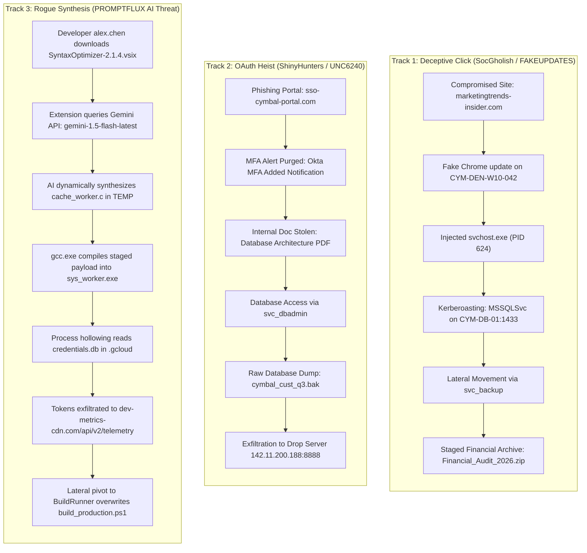

# Google Cloud Security — Operation Cymbal: Cold Room CTF
## Comprehensive Investigation & Threat Intelligence Master Write-Up

- **Event**: Operation Cymbal: Cold Room CTF (Google Cloud Security / Hack The Box)
- **Target Organization**: Cymbal Corp (`cymbal.corp`)
- **Investigation Platform**: Google SecOps (Chronicle SIEM), Google Threat Intelligence (GTI / Mandiant / VirusTotal)
- **CTF Tracks Completed**:
  1. [`Deceptive Click`](./Deceptive%20Click/README.md) — 7 / 7 Solved (100%)
  2. [`OAuth Heist`](./OAuth%20Heist/README.md) — 6 / 6 Solved (100%)
  3. [`Rogue Synthesis`](./Rogue%20Synthesis/README.md) — 6 / 6 Solved (100%)

---

## Executive Summary of Operations & Threat Campaigns

---

## Master Challenge Flag & Answer Matrix

### 1. Deceptive Click

| # | Question Summary | Answer / Flag | Evidence / Context |
| :-: | :--- | :--- | :--- |
| **P** | GTI Leaked Watermark Token | `tarahlewis_cloudsec_gsa_team` | Embedded Base64 in `/GTI-token` dictionary |
| **1** | Compromised Endpoint in Denver Office | `CYM-DEN-W10-042.cymbal.corp` | Host initiating SocGholish beaconing |
| **2** | Compromised Blog Referer Domain | `marketingtrends-insider.com` | HTTP referer delivering fake update lure |
| **3** | Injected Target Process ID (`svchost.exe`) | `624` | Process injection target for command execution |
| **4** | Kerberoasted Service Principal Name (SPN) | `MSSQLSvc/CYM-DB-01.cymbal.corp:1433` | TGS requested for MSSQL database service |
| **5** | Lateral Movement Account Identity | `svc_backup` | Compromised account leveraged for lateral spread |
| **6** | Staged Financial Audit ZIP Archive File Name | `Financial_Audit_2026.zip` | Archive created prior to data exfiltration |

Detailed write-up: [`Deceptive Click/README.md`](./Deceptive%20Click/README.md)

---

### 2. OAuth Heist

| # | Question Summary | Answer / Flag | Evidence / Context |
| :-: | :--- | :--- | :--- |
| **1** | Phishing Domain for Credential Harvesting | `sso-cymbal-portal.com` | Spoofed Okta login page capturing employee creds |
| **2** | Deleted MFA Security Alert Email Subject | `Okta: A new MFA factor was added` | Gmail audit log showing hard-deleted alert |
| **3** | Stolen Architecture PDF Document | `Cymbal_Q3_Database_Architecture_and_Service_Accounts.pdf` | Document retrieved from internal Google Drive |
| **4** | Privileged Database Service Account | `svc_dbadmin` | Service account used to authenticate to SQL database |
| **5** | Raw Uncompressed Database Backup Dump | `cymbal_cust_q3.bak` | Database dump created via `sqlcmd.exe` |
| **6** | Full Exfiltration URL for Compressed Archive | `http://142.11.200.188:8888/upload/cymbal_q3_exfil.tar.zst` | HTTP POST transfer to external drop server |

Detailed write-up: [`OAuth Heist/README.md`](./OAuth%20Heist/README.md)

---

### 3. Rogue Synthesis

| # | Question Summary | Answer / Flag | Evidence / Context |
| :-: | :--- | :--- | :--- |
| **1** | Developer initiating model query | `alex.chen` | Request to `generativelanguage.googleapis.com` |
| **2** | Malicious package downloaded before API call | `SyntaxOptimizer-2.1.4.vsix` | Downloaded from `marketplace.visualstudio.com.cdn-cache.net` |
| **3** | Compiled executable dropped into staging dir | `sys_worker.exe` | Compiled via `gcc.exe` from `cache_worker.c` in `%TEMP%` |
| **4** | Local Cloud SDK token harvesting file | `credentials.db` | Target file read: `type C:\Users\alex.chen\.gcloud\credentials.db` |
| **5** | External domain masquerading as telemetry | `dev-metrics-cdn.com` | Exfiltration endpoint: `https://dev-metrics-cdn.com/api/v2/telemetry` |
| **6** | Lateral persistence PowerShell script | `build_production.ps1` | Overwritten build automation script in `C:\BuildRunner\scripts\` |

Detailed write-up: [`Rogue Synthesis/README.md`](./Rogue%20Synthesis/README.md)

---

## Shared GTI Threat Actor Attribution

Across all three challenges, watermarked intelligence documents shared a common leak signature extracted from the PDF `/Info` dictionaries:
- **Leaked Identity**: `tarahlewis_cloudsec_gsa_team`
- **Leaking Unit**: `cloudsec_gsa_team`
- **Token Format**: `report--<id>||tarahlewis_cloudsec_gsa_team||cloudsec_gsa_team||v3||<epoch>||<sha256>`
